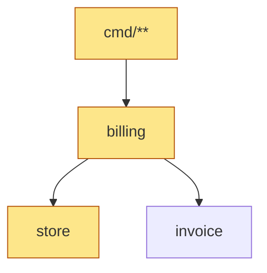

# Placing a change in invox's architecture

`docs/architecture.md` is the map. `TestArchitectureDoc` in `internal/archtest`
generates it from the code and fails when it is stale, so it shows the code as it is.
It has the rings, the package imports, the five ports and `latex.Compiler` with their
implementers, each use case with the commands that call it and the port methods it
reaches, and the import rules.

## 1. Read the map

Read `docs/architecture.md` in full before you plan. Read the code of each package
your plan touches after that; the map tells you which ones.

## 2. Place each part of the change

Put each piece of behavior in the first row that fits.

| The code | Goes in | Ring |
|---|---|---|
| A rule about invoice data: a field, a check, a total, a status transition | `invoice`, or `numbering`, `epc`, `money` | Entities |
| The steps of one user action, in order, and the decisions between them | a method on `billing.Service`, or a helper it calls | Use cases |
| Reading or writing a file, a file format, LaTeX, running a program | a driven adapter behind a port method | Driven adapters |
| A flag, an argument, help text, output wording, a prompt, an editor | `internal/cmd/<noun>/<verb>`, `cli`, `cmdutil`, `helptext` | Driving adapters |
| Choosing and building an adapter | `factory` | Main |

A use case reaches the outside only through a port. A port method carries domain data
only, so its results hold no func fields and no interfaces
(`TestPortsCarryNoAdapterData`). The core never prints, reads the environment, touches
the disk or names a CLI flag.

## 3. Write the change map

Put this table in the plan, and later in the PR description. Mark each row new,
changed or unchanged, and name the exact identifiers.

| Layer | What changes |
|---|---|
| Command | `cmd/...` package, flags, output |
| Use case | `Service` method |
| Port methods | new or changed signatures |
| Adapters | implementing types (`store.Store`, `latex.Renderer`, ...) |
| Entities | types, fields, rules |
| Wiring | `factory` |
| Import rules | any new import between packages |

## 4. Draw it

Copy the Mermaid block from `docs/architecture.md` that shows the change best: the
package diagram for a change across packages, the port class diagram for a port
change. Keep only the nodes the change touches and their neighbors, and mark them:

Show the drawing with the change map and settle the placement before you write code.

## 5. Stop at a new ring crossing

If the change needs an import that the "Import rules" section forbids, or a package in
no ring, that is an architecture decision, not an implementation detail. Say what the
import is and why, and propose a placement that needs no new crossing. Change the
rules only when the maintainer agrees, and then change all of them in the same PR:
the rules in `internal/archtest/archtest_test.go`, the depguard rules in
`.golangci.yml`, and the package description in CLAUDE.md.

## 6. Finish

- A new or changed port method also changes `narrowPorts` in
  `internal/archtest/ports_test.go` and its entry in `docs/design/ports-v2.md`.
- A new package goes into a ring in `internal/archtest/archtest_test.go`;
  `TestArchitectureDoc` fails until it is in one.
- Regenerate the map with `make docs` (or `go test ./internal/archtest -run
  TestArchitectureDoc -update`) and read its diff. It should show what the change map
  promised and nothing else. Commit it with the change.
