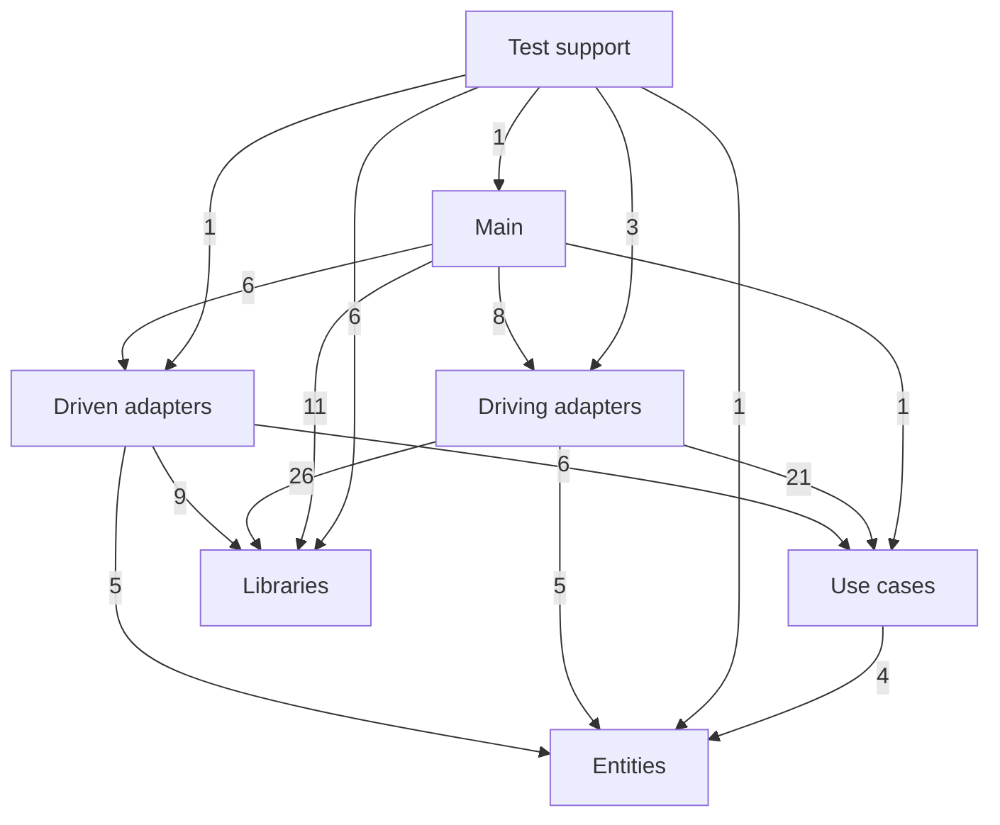
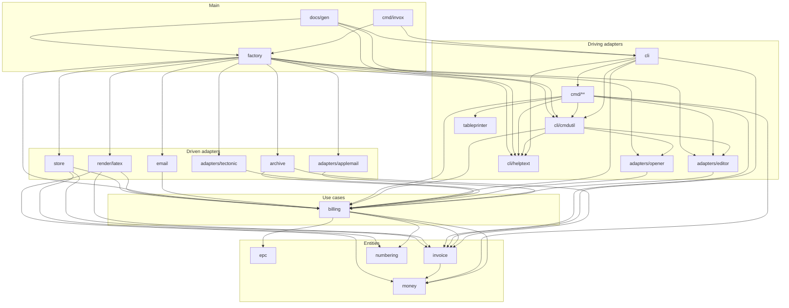
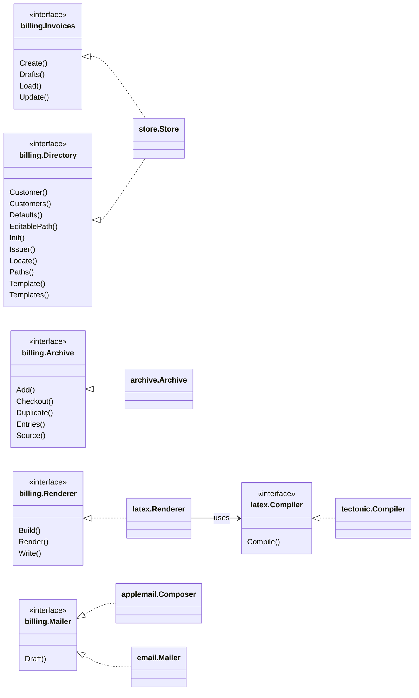

# invox architecture

<!-- Generated by TestArchitectureDoc in internal/archtest. Do not edit; run
     go test ./internal/archtest -run TestArchitectureDoc -update -->

The code follows the clean architecture of `docs/design/target/README.md`. Source
dependencies point inward, from main to the adapters to the use cases to the
entities. This page is generated from the code, so it shows what is there now.
The import rules at the end are the ones `internal/archtest` and depguard enforce.
To plan a change against it, follow `.claude/skills/invox-architecture/SKILL.md`.

## Rings

Each arrow is at least one direct import; the label counts the package imports.



## Packages

Direct imports between the release binary's packages. The 22 command packages are
folded into `cmd/**`. Imports of the libraries and the test support packages are
in the table below.



| Package | Ring | Imports from the module |
|---|---|---|
| `cmd/invox` | Main | `internal/adapters/run`, `internal/cli`, `internal/env`, `internal/factory`, `internal/iostreams` |
| `internal/adapters/applemail` | Driven adapters | `internal/adapters/run`, `internal/billing`, `internal/iostreams` |
| `internal/adapters/editor` | Driving adapters | `internal/adapters/run`, `internal/billing`, `internal/iostreams` |
| `internal/adapters/opener` | Driving adapters | `internal/adapters/run`, `internal/billing`, `internal/iostreams` |
| `internal/adapters/run` | Libraries | none |
| `internal/adapters/run/runtest` | Test support | `internal/adapters/run` |
| `internal/adapters/tectonic` | Driven adapters | `internal/adapters/run`, `internal/billing`, `internal/iostreams` |
| `internal/archive` | Driven adapters | `internal/billing`, `internal/fsutil`, `internal/invoice` |
| `internal/billing` | Use cases | `internal/epc`, `internal/invoice`, `internal/money`, `internal/numbering` |
| `internal/build` | Libraries | none |
| `internal/cli` | Driving adapters | `internal/billing`, `internal/cli/cmdutil`, `internal/cli/helptext`, `internal/cmd/completion`, `internal/cmd/config`, `internal/cmd/customer`, `internal/cmd/init`, `internal/cmd/invoice/archive`, `internal/cmd/invoice/build`, `internal/cmd/invoice/email`, `internal/cmd/invoice/increment`, `internal/cmd/invoice/new`, `internal/cmd/invoice/render`, `internal/cmd/invoice/validate`, `internal/cmd/template`, `internal/cmd/version`, `internal/invoice` |
| `internal/cli/cmdutil` | Driving adapters | `internal/adapters/editor`, `internal/adapters/opener`, `internal/billing`, `internal/cli/helptext`, `internal/env`, `internal/iostreams` |
| `internal/cli/helptext` | Driving adapters | none |
| `internal/clitest` | Test support | `internal/adapters/run`, `internal/adapters/run/runtest`, `internal/cli`, `internal/cli/cmdutil`, `internal/factory/factorytest`, `internal/iostreams`, `internal/testfixture` |
| `internal/cmd/completion` | Driving adapters | `internal/cli/cmdutil`, `internal/iostreams` |
| `internal/cmd/config` | Driving adapters | `internal/billing`, `internal/cli/cmdutil`, `internal/cmd/config/edit`, `internal/cmd/config/paths` |
| `internal/cmd/config/edit` | Driving adapters | `internal/adapters/editor`, `internal/billing`, `internal/cli/cmdutil`, `internal/iostreams` |
| `internal/cmd/config/paths` | Driving adapters | `internal/billing`, `internal/cli/cmdutil`, `internal/iostreams`, `internal/tableprinter` |
| `internal/cmd/customer` | Driving adapters | `internal/cli/cmdutil`, `internal/cmd/customer/edit`, `internal/cmd/customer/list` |
| `internal/cmd/customer/edit` | Driving adapters | `internal/adapters/editor`, `internal/billing`, `internal/cli/cmdutil`, `internal/cli/helptext`, `internal/iostreams` |
| `internal/cmd/customer/list` | Driving adapters | `internal/billing`, `internal/cli/cmdutil`, `internal/cli/helptext`, `internal/iostreams`, `internal/tableprinter` |
| `internal/cmd/init` | Driving adapters | `internal/billing`, `internal/cli/cmdutil`, `internal/iostreams` |
| `internal/cmd/invoice/archive` | Driving adapters | `internal/cli/cmdutil`, `internal/cli/helptext`, `internal/cmd/invoice/archive/add`, `internal/cmd/invoice/archive/edit`, `internal/cmd/invoice/archive/list` |
| `internal/cmd/invoice/archive/add` | Driving adapters | `internal/billing`, `internal/cli/cmdutil`, `internal/cli/helptext`, `internal/cmd/invoice/shared`, `internal/iostreams` |
| `internal/cmd/invoice/archive/edit` | Driving adapters | `internal/billing`, `internal/cli/cmdutil`, `internal/cli/helptext`, `internal/iostreams` |
| `internal/cmd/invoice/archive/list` | Driving adapters | `internal/billing`, `internal/cli/cmdutil`, `internal/cli/helptext`, `internal/cmd/invoice/shared`, `internal/iostreams`, `internal/tableprinter` |
| `internal/cmd/invoice/build` | Driving adapters | `internal/billing`, `internal/cli/cmdutil`, `internal/cli/helptext`, `internal/cmd/invoice/shared`, `internal/invoice`, `internal/iostreams` |
| `internal/cmd/invoice/email` | Driving adapters | `internal/billing`, `internal/cli/cmdutil`, `internal/cli/helptext`, `internal/cmd/invoice/shared`, `internal/iostreams` |
| `internal/cmd/invoice/increment` | Driving adapters | `internal/billing`, `internal/cli/cmdutil`, `internal/cli/helptext`, `internal/cmd/invoice/shared`, `internal/iostreams` |
| `internal/cmd/invoice/new` | Driving adapters | `internal/adapters/editor`, `internal/billing`, `internal/cli/cmdutil`, `internal/cli/helptext`, `internal/cmd/invoice/shared`, `internal/iostreams` |
| `internal/cmd/invoice/render` | Driving adapters | `internal/billing`, `internal/cli/cmdutil`, `internal/cli/helptext`, `internal/cmd/invoice/shared`, `internal/iostreams` |
| `internal/cmd/invoice/shared` | Driving adapters | `internal/billing`, `internal/cli/cmdutil`, `internal/invoice`, `internal/iostreams` |
| `internal/cmd/invoice/validate` | Driving adapters | `internal/billing`, `internal/cli/cmdutil`, `internal/cli/helptext`, `internal/cmd/invoice/shared`, `internal/invoice`, `internal/iostreams`, `internal/money` |
| `internal/cmd/template` | Driving adapters | `internal/cli/cmdutil`, `internal/cmd/template/list` |
| `internal/cmd/template/list` | Driving adapters | `internal/billing`, `internal/cli/cmdutil`, `internal/iostreams`, `internal/tableprinter` |
| `internal/cmd/version` | Driving adapters | `internal/build`, `internal/cli/cmdutil`, `internal/iostreams` |
| `internal/config` | Libraries | none |
| `internal/docs/gen` | Main | `internal/adapters/run`, `internal/cli`, `internal/cli/cmdutil`, `internal/cli/helptext`, `internal/env`, `internal/factory`, `internal/fsutil`, `internal/iostreams` |
| `internal/email` | Driven adapters | `internal/billing`, `internal/fsutil` |
| `internal/env` | Libraries | none |
| `internal/epc` | Entities | none |
| `internal/factory` | Main | `internal/adapters/applemail`, `internal/adapters/editor`, `internal/adapters/opener`, `internal/adapters/run`, `internal/adapters/tectonic`, `internal/archive`, `internal/billing`, `internal/cli/cmdutil`, `internal/cli/helptext`, `internal/email`, `internal/env`, `internal/fsutil`, `internal/iostreams`, `internal/render/latex`, `internal/store` |
| `internal/factory/factorytest` | Test support | `internal/adapters/run`, `internal/adapters/run/runtest`, `internal/cli/cmdutil`, `internal/env`, `internal/factory`, `internal/invoice`, `internal/iostreams`, `internal/store` |
| `internal/fsutil` | Libraries | none |
| `internal/invoice` | Entities | `internal/money` |
| `internal/iostreams` | Libraries | none |
| `internal/money` | Entities | none |
| `internal/numbering` | Entities | none |
| `internal/render/latex` | Driven adapters | `internal/billing`, `internal/fsutil`, `internal/invoice`, `internal/money` |
| `internal/store` | Driven adapters | `internal/billing`, `internal/config`, `internal/fsutil`, `internal/invoice`, `internal/numbering` |
| `internal/tableprinter` | Driving adapters | `internal/iostreams` |
| `internal/testfixture` | Test support | none |

## Ports

The use cases reach the outside only through these interfaces. `billing` owns the
five ports; `render/latex` owns the compiler it builds PDFs with.



**billing.Invoices**, implemented by `store.Store`:

```go
Create(path string, from string, inv invoice.Invoice, opts CreateOptions) (string, error)
Drafts(workDir string, output string) []invoice.Invoice
Load(path string) (invoice.Invoice, error)
Update(path string, change func(*invoice.Invoice) error) error
```

**billing.Directory**, implemented by `store.Store`:

```go
Customer(id string) (invoice.Customer, error)
Customers() ([]CustomerEntry, error)
Defaults() (string, error)
EditablePath(f File) (string, error)
Init() (string, []InitFile, error)
Issuer() (invoice.Issuer, error)
Locate(f File) (string, error)
Paths() ([]PathReport, error)
Template(ref string) (Template, error)
Templates() ([]Template, string, error)
```

**billing.Archive**, implemented by `archive.Archive`:

```go
Add(src string, inv invoice.Invoice, opts AddOptions) (ArchiveResult, error)
Checkout(ref string, workDir string) (Checkout, error)
Duplicate(src string, inv invoice.Invoice) (string, Unread, error)
Entries() ([]ArchiveEntry, Unread, error)
Source(pdf string) (string, Unread, error)
```

**billing.Renderer**, implemented by `latex.Renderer`:

```go
Build(ctx context.Context, t Template, source string, output string) error
Render(t Template, inv *invoice.Context, epc EPC) (string, error)
Write(t Template, source string, path string) error
```

**billing.Mailer**, implemented by `applemail.Composer`, `email.Mailer`:

```go
Draft(ctx context.Context, m Message, dryRun bool) (string, error)
```

**latex.Compiler**, implemented by `tectonic.Compiler`:

```go
Compile(ctx context.Context, sourcePath string) (string, error)
```

## Use cases

Each use case is one method on `billing.Service`. "Commands" are the packages under
`internal/cmd` that call it; "Port methods" are every port method it reaches,
through `billing`'s own helpers too.

| Use case | Commands | Port methods |
|---|---|---|
| `Archive` | `cmd/invoice/archive/add` | `Archive.Add`, `Archive.Duplicate`, `Invoices.Load` |
| `Build` | `cmd/invoice/build` | `Archive.Add`, `Archive.Duplicate`, `Directory.Customers`, `Directory.Issuer`, `Directory.Locate`, `Directory.Template`, `Invoices.Load`, `Invoices.Update`, `Renderer.Build`, `Renderer.Render` |
| `DraftEmail` | `cmd/invoice/email` | `Archive.Source`, `Directory.Customers`, `Directory.Issuer`, `Directory.Locate`, `Invoices.Load`, `Mailer.Draft` |
| `EditArchived` | `cmd/invoice/archive/edit` | `Archive.Checkout`, `Invoices.Create`, `Invoices.Load` |
| `EditablePath` | `cmd/config/edit`, `cmd/customer/edit` | `Directory.EditablePath` |
| `Increment` | `cmd/invoice/increment` | `Archive.Entries`, `Directory.Customer`, `Directory.Locate`, `Invoices.Load`, `Invoices.Update` |
| `Init` | `cmd/init` | `Directory.Init` |
| `ListArchive` | `cmd/invoice/archive/list` | `Archive.Entries` |
| `ListCustomers` | `cmd/customer/list` | `Directory.Customers`, `Directory.Locate` |
| `ListTemplates` | `cmd/template/list` | `Directory.Locate`, `Directory.Templates` |
| `New` | `cmd/invoice/new` | `Archive.Entries`, `Directory.Customer`, `Directory.Defaults`, `Directory.Issuer`, `Directory.Locate`, `Invoices.Create`, `Invoices.Drafts`, `Invoices.Load` |
| `Paths` | `cmd/config/paths` | `Directory.Paths` |
| `Render` | `cmd/invoice/render` | `Directory.Customers`, `Directory.Issuer`, `Directory.Locate`, `Directory.Template`, `Invoices.Load`, `Renderer.Render`, `Renderer.Write` |
| `Validate` | `cmd/invoice/validate` | `Archive.Duplicate`, `Directory.Customers`, `Directory.Issuer`, `Directory.Locate`, `Invoices.Load` |

## Import rules

`internal/archtest` fails when one of these breaks; `.golangci.yml` states the
same rules for depguard, one file at a time.

- entities: invoice imports only money and touches no disk
- entities: numbering, epc and money import only the standard library and touch no disk
- use cases: billing imports only the entities and touches no disk
- the core depends on no adapter, library, framework, CLI or main package, even indirectly
- driven: store imports the core, config, fsutil and yaml.v3
- driven: archive, render/latex and email import the core and fsutil
- driven: tectonic and applemail import the core, run and iostreams
- driving adapters import the core, each other, run, iostreams, env, build, cobra and pflag, never a driven adapter, config, fsutil or factory
- main: factory builds everything but never imports the CLI root or a command
- main: cmd/invox imports factory, cli and the process libraries
- main: docs/gen imports factory, the CLI, cobra and the process libraries
- libraries import only the standard library
- test support: runtest imports only run
- test support: testfixture imports only the standard library
- test support: clitest runs the CLI on factorytest, runtest and testfixture
- the release binary contains neither the docs generator nor the test support packages
- only the CLI and main know about commands and flag parsing
- only internal/adapters/run starts programs
